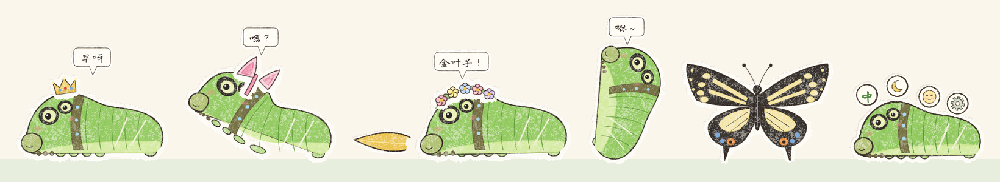
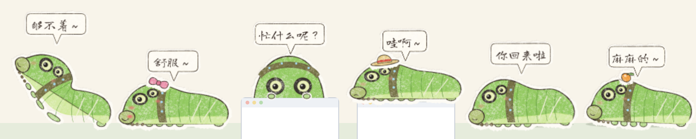

# 肥嘟嘟桌宠 · FeiDuDu Desktop Pet

一只柑橘凤蝶的小绿虫，住在你的屏幕上。蜡笔画的，会爬、会吐丝、会吃叶子、会拉便便，有人来了还会伪装成输入法。

A little swallowtail caterpillar (*Papilio xuthus*) that lives on your screen: hand-drawn in crayon, it crawls, spins silk, eats leaves, poops — and disguises itself as an input-method skin when someone walks by.

[中文](#中文) · [English](#english)

---

## 中文

### 打开

需要 Windows 和 [Python 3](https://www.python.org/downloads/)（装的时候勾上 “Add python.exe to PATH”）。

1. 下载这个项目（绿色的 **Code** 按钮 → **Download ZIP**），解压。
2. 双击 `feidudu.pyw`，肥嘟嘟就出现在任务栏上面了。
   - 第一次打开会弹个小框，点「确定」它自己装一下 PyQt6（只装一次，一两分钟，要联网），装好就出来。
   - 已经开着的时候再双击一次，不会多出一只，而是把它叫出来。
   - 打开一次以后，文件夹里会多一个带肥嘟嘟图标的「肥嘟嘟」快捷方式，以后点它就行，也可以拖到桌面上。
   - 出了问题会弹个小框，详细的记在 `feidudu_error.log` 里。
   - 双击没反应、或者用记事本打开了：右键 `feidudu.pyw` →「打开方式」→ 选 Python（pythonw），勾上“始终使用”。
3. 想开机自动出来：`Win+R` 输入 `shell:startup` 回车，把「肥嘟嘟」快捷方式复制一份放进打开的文件夹。

### 它自己会

- 在任务栏上爬、发呆、扭一扭；晚上 11 点到早上 7 点更爱睡觉，吃饱了白天也睡个午觉
- 按时间打招呼：早呀、中午好、下午好、晚上好、夜深啦（默认跟电脑时间，`config.py` 里的 `TIMEZONE` 可以改时区）
- 一顿一顿地吃：20 分钟里连吃 3 片就饱了，45 分钟吃不下（“吃不下了”）；睡着的时候也不吃
- 偶尔自己找点叶子边啃一小口，过一会儿拉一颗便便（很少，一小时多一次）
- 顺着屏幕边往上爬，倒挂着在屏幕顶上爬；爬上**当前活动窗口**的侧边和上沿，窗口被拖走会跟着走
  （拖得太快它会压低身子死死抓住：哇啊～；来回甩得太狠就被甩下来，吐丝降落）
- 要下来的时候吐一根丝慢慢垂下来；脚下的窗口没了也马上吐丝，不会摔着
- 爬到边上先抬起前半身晃一晃、探探路（真的毛毛虫在叶子边上就这样）
- 爬过的地方留下细细的丝，常走的地方丝越来越多
- 吃过叶子过一会儿，抬抬尾巴拉一颗小便便，掉到任务栏上
- 鼠标停在它旁边，它会好奇地抬起前半身，头跟着鼠标转；鼠标跑到身后它就转身，慢慢挪远了就爬过去接着看，
  太高了够不着会说“够不着～”；鼠标飞快地从它身上划过，偶尔会吓一跳
- 你在忙（一直在打字、滚网页）的时候，它更爱待在窗口上，还会躲到窗口后面，只露出脑袋和两只小脚偷看你（忙什么呢？）；
  你忙完一阵停下来，它问“忙完啦？”；连着忙了 50 分钟，它提醒你“歇一下？”（右键「提醒我歇一歇」可以关掉）
- 你走开几分钟（不碰键盘鼠标），它就找个地方睡；你一回来它就醒，说“你回来啦”，朝鼠标急急地爬过来

### 你可以

| 操作 | 它会 |
|---|---|
| 单击 | 多半扭扭～，有时冒出橙色小角（哼！） |
| 连着快戳三下 | 装成小蛇吓唬你：抬起前半身、胸口鼓起来让假眼睛变大、冒出小角（嘶——！） |
| **双击**，或者按 **Ctrl+Alt+Z** | **马上藏起来，伪装成输入法**（见下面；快捷键再按一次就出来） |
| 按住往外拉 | 死死抓住（不放！），要拉满坚持一会儿才松手（哇啊～） |
| 拎起来 | 团成一个小 C 字，嘟着嘴不高兴地扭，松手它吐丝降落 |
| 鼠标（不按键）在它身上来回划 | 摸摸：它舒服得瘫下来、脸红红的（舒服～）；一直摸会被摸睡着 |
| 点地上的小便便 | 捡起来，攒着当花肥 |
| 右键 | 蜡笔边框的小菜单：喂叶子、捡便便、小卖部、衣柜、大小、安静一会儿、提醒我歇一歇、退出 |
| 右键托盘图标 | 安静一会儿、回到任务栏上（万一它卡在奇怪的地方）、退出 |
| 单击托盘图标 | 扭一扭；在安静的时候就叫它出来 |

**伪装**：双击它（或者按 Ctrl+Alt+Z），肥嘟嘟、丝、便便、托盘图标全藏好，只剩一个卡通皮肤的“输入法”——
一只趴着的肥嘟嘟，背上浮着「中/英」「全半角」「表情」「设置」小圆按钮，点了会像真的一样切换，还能拖动。
回来以后双击卡片上的肥嘟嘟，或者右键「还原」。

**安静一会儿**（打游戏的时候）：右键它或者托盘图标选「安静一会儿」，它就藏起来、什么都不做，不占电脑资源，
只留托盘里的小蝴蝶；单击小蝴蝶就叫它出来。也可以让它自己知道：在 `my_config.py` 里写上游戏的程序名
（任务管理器 →「详细信息」那一栏），比如 `GAMES = ("GenshinImpact.exe",)`，游戏在最前面它就自己去睡，切走就出来；
带反作弊读不到程序名的游戏，可以写窗口标题里的字：`GAME_TITLES = ("原神",)`。

### 小卖部

用捡来的花肥换东西（右键「小卖部」）：

- **抽一片神秘叶子**（5 颗），都是柑橘凤蝶真的会吃的芸香科植物：
  花椒叶、山椒叶（麻麻的～）、柚子叶（吃得好撑，多拉几颗便便）、柠檬叶（酸！）、黄檗叶（吃完睡个长长的午觉）、
  金橘叶、枳叶；少见的是**芸香叶**（半小时身边飘着香味）；
  运气好是**金叶子**（接下来一小时身边亮晶晶）；
  极少见的是**梦蝶叶**：它会困、变成蛹、变成蝴蝶在屏幕上飞 10 分钟，最后落回来说“做了个梦…”（庄周梦蝶）；
  偶尔还会抽到**枫叶**——它闻一闻：才不吃！我只吃芸香科！然后嘟着嘴等你**点一下枫叶把它拿走**（花肥不扣）。
  柑橘凤蝶的毛毛虫很挑食：只吃芸香科（柑橘、花椒这一家）的叶子，别的再好看也不当饭
- **饰品**：蝴蝶结、小橘子发卡、小柠檬发卡、触角发箍 10；猫耳、兔耳、熊耳头箍、生日帽 12；玳瑁眼镜（戴在假眼睛上）、小围巾 14；
  花环 15；小草帽、小书包 16；小礼帽、圣诞帽 18；小王冠 20 颗。买过的在右键「衣柜」里换着戴

吃了几片叶子、攒了几颗花肥、买过什么都记在 `feidudu_save.json` 里；删掉它就回到刚孵出来的样子。

### Mac

还没有正式支持。用终端跑 `pip3 install PyQt6` 再 `python3 feidudu.pyw` 应该能动，
但不会爬窗口、Dock 里会多一个 Python 图标，也没在真的 Mac 上试过。

### 想改一改

- 程序在 `feidudu_pet/`，一个动作一个文件（`feidudu_pet/behaviors/`），能调的数字都在 `feidudu_pet/config.py`
- 想调数字的话，别直接改 `config.py`：在 `feidudu.pyw` 旁边新建一个 `my_config.py`，只写要改的那几行（比如 `AWAY_AFTER = 600`），
  它会盖过 `config.py` 里的同名数字。它不进 git，以后 `git pull` 更新不会冲突
- 小卖部的货架（饰品、叶子、价钱、机会）在 `art-source/items.js`
- 画面是 `art-source/` 里的蜡笔画笔（JavaScript + 无头 Chromium）画的：
  `pip install playwright pillow`、`playwright install chromium`，然后 `python art-source/runpet.py` 重画整个 `sprites/`
- 代码是怎么搭起来的，写在 [`CLAUDE.md`](CLAUDE.md)（给 Claude Code 看的，人也能看）

### 作者

- 肥嘟嘟和它的绘本世界：**Silmaril**
- 代码和桌宠的蜡笔画帧：**Claude**（Anthropic 的 AI）——和 Silmaril 一起，一个动作一个动作做出来的 🐛
- 泡泡里的字：[龙藏体 Long Cang](https://github.com/googlefonts/longcang)（SIL Open Font License）

### 授权

代码是 MIT，随便用随便改；肥嘟嘟的形象和画是 CC BY-NC 4.0：可以分享、改编，要署名「肥嘟嘟 © Silmaril」，不能商用。
哪些文件算哪部分，见 [`LICENSE`](LICENSE) 和 [`LICENSE-ART.md`](LICENSE-ART.md)。

---

## English

### Running it

You need Windows and [Python 3](https://www.python.org/downloads/) (tick "Add python.exe to PATH" when installing).

1. Download this project (green **Code** button → **Download ZIP**) and unzip it.
2. Double-click `feidudu.pyw`. FeiDuDu appears on top of your taskbar.
   - The first time, a small dialog asks to install PyQt6 (once, takes a minute or two, needs internet).
   - Double-clicking again while it's running doesn't make a second one; it calls the existing one out.
   - After the first run, the folder has a "肥嘟嘟" shortcut with FeiDuDu's icon — use that from then on, or drag it to your desktop.
   - If something goes wrong you'll get a dialog, and details go to `feidudu_error.log`.
   - If double-clicking does nothing or opens Notepad: right-click `feidudu.pyw` → Open with → Python (pythonw) → Always.
3. To start it with Windows: `Win+R`, type `shell:startup`, and copy the "肥嘟嘟" shortcut into that folder.

### What it does on its own

- Crawls along the taskbar, idles, wiggles; sleeps more between 11 pm and 7 am, and naps after eating
- Greets you by time of day (follows your computer's clock; set `TIMEZONE` in `config.py` to change it)
- Eats in meals: 3 leaves within 20 minutes and it's full for 45 minutes ("吃不下了"); it won't eat while asleep either
- Now and then nibbles a leaf edge on its own and drops a pellet a while later (rare — a bit over once an hour)
- Climbs up the screen edges and crawls upside down along the top; climbs the sides and top of the **active window**, and rides along when you drag it
  (drag too fast and it flattens itself and holds on for dear life; shake the window hard and it gets flung off and drops on silk)
- Lowers itself on a silk thread to get down — and spins one instantly if the window under it disappears
- At an edge, it rears up and feels around for the next foothold first, like real caterpillars do at a leaf's edge
- Leaves a faint silk trail where it walks; favourite paths get more silk
- A while after eating, it lifts its tail and drops a little frass pellet onto the taskbar
- Rest your cursor near it and it rears up curiously, head following the cursor; it turns around if you go behind it,
  crawls after the cursor if you drift away slowly, and says "够不着～" (can't reach!) when it's too high; whip the cursor across it and it may jump
- While you're busy (typing or scrolling steadily) it likes to be on your window, and ducks behind its top edge to peek at you
  with just its face and two little feet showing (忙什么呢？ — what'cha doing?); when you stop after a long stretch it asks "忙完啦？" (all done?),
  and after 50 minutes straight it suggests "歇一下？" (take a break?) — turn that off with right-click → 提醒我歇一歇
- When you step away for a few minutes (no keyboard or mouse), it finds a spot and sleeps; when you're back it wakes up, says "你回来啦" (you're back!) and hurries toward your cursor

### What you can do

| Action | Result |
|---|---|
| Click | Usually a wiggle; sometimes its orange osmeterium pops out (hmph!) |
| Three quick clicks | Snake pose: it rears up, swells its thorax so the false eyes look huge, and shows its horns — like real swallowtail caterpillars scaring off birds |
| **Double-click**, or **Ctrl+Alt+Z** | **Hides instantly and disguises itself as an input method** (see below; press the hotkey again to come back) |
| Press and pull | It clings on ("不放!") and only lets go after a strong, sustained pull |
| Lift it | Curls into a grumpy little C; let go and it drops down on silk |
| Stroke it with the mouse (no button, back and forth) | Petting: it melts a little flatter and blushes (舒服～); keep going and it falls asleep |
| Click a frass pellet | Picks it up — frass is fertilizer, the shop's currency |
| Right-click | A little crayon-framed menu: feed, pick up frass, shop, wardrobe, size, quiet time, break reminder, quit |
| Right-click the tray icon | Quiet time, back to the taskbar (in case it gets stuck somewhere odd), quit |
| Click the tray icon | A wiggle; during quiet time, calls it back out |

**Disguise:** double-click it (or press Ctrl+Alt+Z) and the caterpillar, silk, frass and tray icon all hide.
All that's left is a cartoon "input method skin": a caterpillar lying down with little round buttons along its back
(中/英, full/half width, emoji, settings) that toggle like the real thing and can be dragged around.
Double-click the caterpillar on the skin, or right-click → 还原, to bring it back.

**Quiet time** (for gaming): right-click it or the tray icon → 安静一会儿, and it hides and stops completely (no CPU use);
only the tray butterfly stays — click it to bring FeiDuDu back. Or let it notice by itself: list your games' program names
(Task Manager → Details) in `my_config.py`, e.g. `GAMES = ("GenshinImpact.exe",)`, and it sleeps whenever one is in front
and comes back when you switch away. For games whose anti-cheat hides the program name, match the window title instead: `GAME_TITLES = ("原神",)`.

### The shop

Spend collected frass (right-click → 小卖部):

- **Mystery leaf** (5 frass), all real host plants of this butterfly (the citrus family, Rutaceae):
  Sichuan pepper and Japanese pepper (tingly!), pomelo (so filling it poops extra pellets), lemon (sour!),
  amur cork tree (a long nap afterwards), kumquat, trifoliate orange; less often **rue** (a lingering scent for half an hour);
  with luck a **golden leaf** (sparkles for an hour);
  very rarely a **dream leaf**: it gets sleepy, pupates, and flies around your screen as a butterfly for 10 minutes,
  then lands and says "I had a dream…" (after Zhuangzi's butterfly dream);
  and sometimes a **maple leaf** — it sniffs it, refuses ("only citrus-family leaves for me!") and sulks until you
  **click the leaf to take it away** (no frass spent). Swallowtail caterpillars really are picky specialists: they only eat plants in the citrus family (Rutaceae)
- **Accessories**: bow, little orange and lemon hair clips, bobble antennae 10; cat / bunny / bear ear headbands, party hat 12; tortoiseshell glasses (worn on the false eyes), scarf 14;
  flower crown 15; straw hat, backpack 16; top hat, Christmas hat 18; little crown 20. Switch between them in right-click → 衣柜 (wardrobe)

Leaves eaten, frass saved and things bought live in `feidudu_save.json`; delete it to start over from a fresh hatchling.

### Mac

Not officially supported yet. `pip3 install PyQt6` then `python3 feidudu.pyw` in Terminal should mostly work,
but it won't climb windows, a Python icon shows in the Dock, and it hasn't been tried on a real Mac.

### Tinkering

- The program is in `feidudu_pet/`, one file per behaviour (`feidudu_pet/behaviors/`); tunable numbers are in `feidudu_pet/config.py`
- To tune numbers, don't edit `config.py` itself: create `my_config.py` next to `feidudu.pyw` with just the lines you want to change
  (e.g. `AWAY_AFTER = 600`). It overrides `config.py` and isn't tracked by git, so `git pull` never conflicts with it
- The shop's shelf (accessories, leaves, prices, odds) is `art-source/items.js`
- All art is drawn by the crayon renderer in `art-source/` (JavaScript + headless Chromium):
  `pip install playwright pillow`, `playwright install chromium`, then `python art-source/runpet.py` redraws all of `sprites/`
- How the code fits together is in [`CLAUDE.md`](CLAUDE.md) (written for Claude Code, readable by humans; in Chinese)

### Credits

- FeiDuDu and its picture-book world: **Silmaril**
- Code and the pet's crayon animation frames: **Claude** (Anthropic's AI) — built together with Silmaril, one behaviour at a time 🐛
- Font in the speech bubbles: [Long Cang](https://github.com/googlefonts/longcang) (SIL Open Font License)

### License

The code is MIT — use it and change it freely. FeiDuDu's character and artwork are CC BY-NC 4.0: share and adapt them
with credit ("FeiDuDu © Silmaril"), but not commercially. Which files fall under which is in [`LICENSE`](LICENSE) and [`LICENSE-ART.md`](LICENSE-ART.md).
